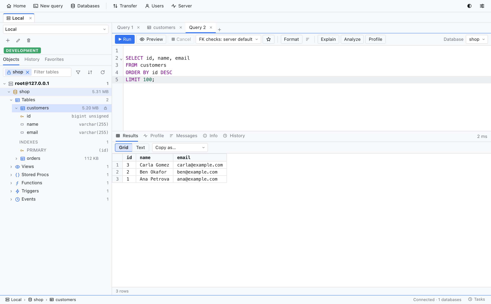
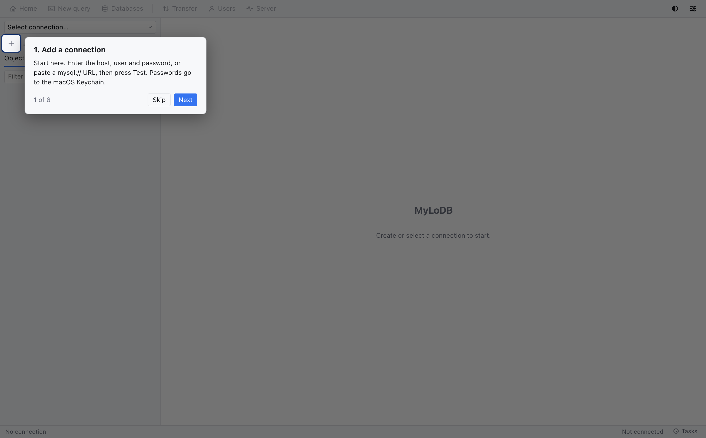
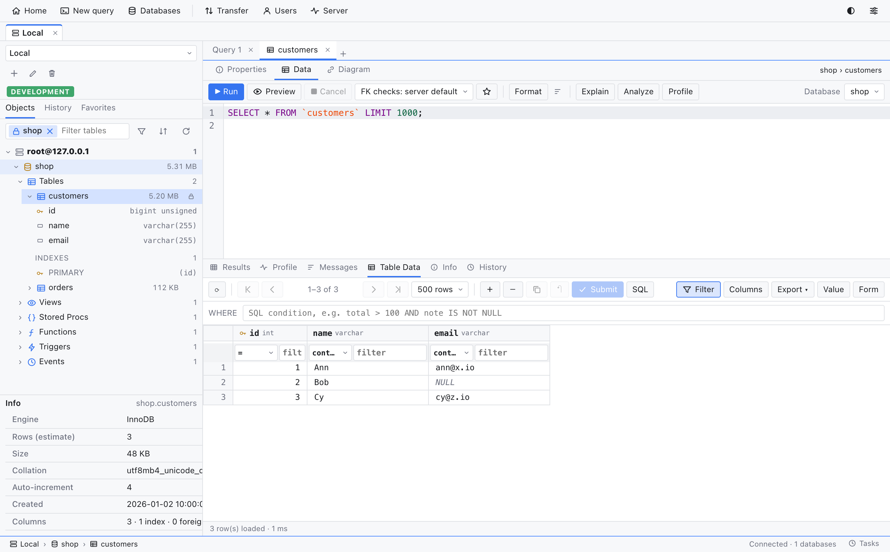
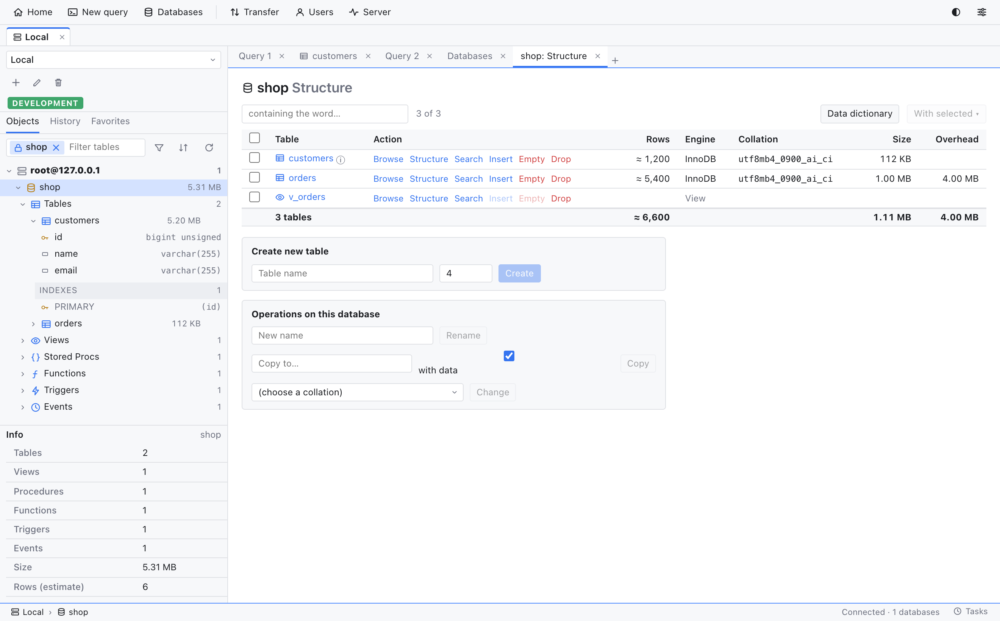
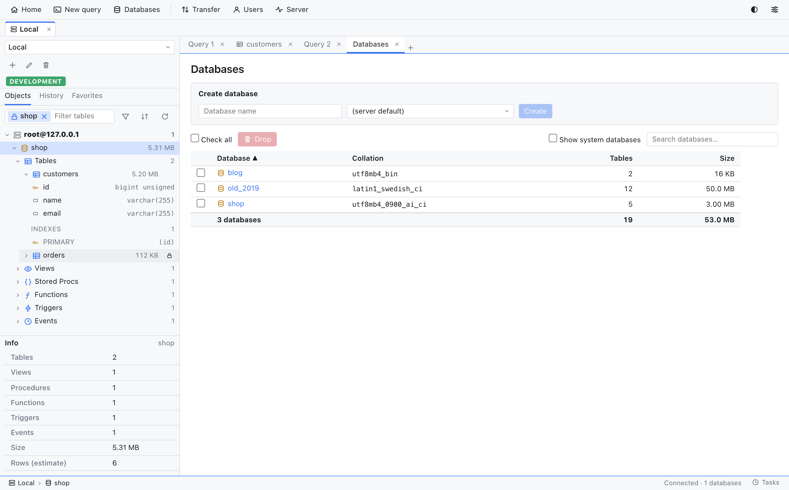
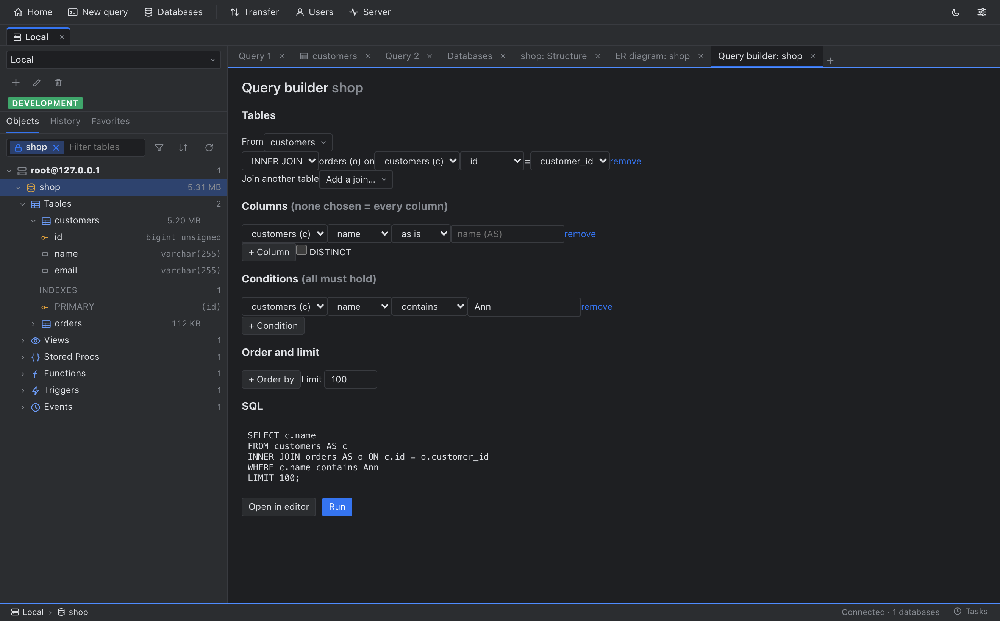

<h1 align="center">MyLoDB</h1>

<p align="center">
  <b>An open-source MySQL, MariaDB and SQLite manager for macOS, written in Rust and React.</b><br>
  Browse, query, edit, design and administer your databases in one fast native window.
</p>

<p align="center">
  <a href="https://github.com/farookhridoy/mylodb/releases/latest"></a>
  
  
  <a href="LICENSE"></a>
</p>

<p align="center">
  <a href="https://farookhridoy.github.io/mylodb/">Website</a> ·
  <a href="#download-and-install">Download</a> ·
  <a href="#quick-start">Quick start</a> ·
  <a href="#features">Features</a> ·
  <a href="#performance">Performance</a> ·
  <a href="docs/MANUAL.md">Full manual</a> ·
  <a href="docs/ROADMAP.md">Roadmap</a> ·
  <a href="#about-the-author">Author</a>
</p>

<p align="center">
  
</p>

> [!IMPORTANT]
> **The first time you open MyLoDB, macOS shows a warning. That is expected.** The app is not signed with a paid Apple Developer certificate.
> Click **Done** (not *Move to Trash*), then **System Settings → Privacy & Security → Open Anyway**. [Step-by-step](#how-to-install-and-open-mylodb).

MyLoDB is for people who miss SQLyog on the Mac. It connects to MySQL and MariaDB (and opens SQLite files) and gives you a tree of your objects with a fast filter, a SQL editor with autocomplete, an editable data grid, a table designer, user and privilege management, server tools, and backup and import. It is built for safety (production colouring, server-enforced read-only, a review before destructive SQL) and for big tables (keyset paging, windowed grid, streamed exports).

*Screenshots show the real interface running on demo data, not a real server.*

## Features

| | |
|---|---|
| **Object browser** | Databases, tables, views, routines, triggers and events with sizes. Filter with `ord*`, `/regex/`, `type:view`, `db:shop`, `col:email`. The Info tab shows facts about the selected object. Drag a name into the editor. |
| **SQL editor** | MySQL-aware autocomplete (tables, columns, aliases), formatter, run selection (⌘↵), cancel, multi-result tabs, Explain and profiler, history, favorites, your own snippets, `.sql` files. |
| **Data grid** | Server-side paging, filter row, multi-column sort, staged inline edits in one transaction, foreign-key picker, BLOB viewer, copy as TSV / CSV / JSON / Markdown / INSERT. |
| **Table designer** | Columns, indexes, foreign keys, options, with the exact `ALTER TABLE` previewed. Renames keep data. |
| **Admin pages** | Databases list with sizes and bulk drop, per-database Structure page with a **With selected** menu, Operations, Data dictionary, Engines / charsets / replication. Every destructive action shows **Preview SQL** first. |
| **Users and privileges** | Create, rename, lock, drop; global, database, table and column privileges shown as the exact GRANT / REVOKE diff. |
| **Server tools** | Live overview, process list (kill), variables, status, maintenance (CHECK / OPTIMIZE / REPAIR), logs. |
| **Backup and import** | Consistent SQL backup (one file or per table, optional zip), restore with a script preview, CSV import with column mapping, export to CSV, JSON, JSON Lines, SQL, XML, HTML, Excel. |
| **Visual tools** | A visual **query builder** (tables, joins from foreign keys, columns with functions, conditions, order, limit; the SQL is built and quoted by the backend) and a whole-database **ER diagram** (drag, zoom, filter, copy as Mermaid). |
| **Analysis tools** | **Schema compare** (make one database match another, with Preview SQL), **data search** across every table, an **index advisor** (duplicate, redundant, missing foreign key indexes), live **server charts**, and **JSON / JSON Lines import**. |
| **SQLite** | Open a `.sqlite` / `.db` file (writable, or read-only if you choose): browse tables, views and triggers, run SQL that changes data, edit rows in the data grid, page, sort and filter. Features a file cannot have (users, server tools, backup) are disabled with the reason. |
| **Connections** | Passwords in the macOS Keychain. SSH tunnels (host key confirmation), SSL modes, connect by URL, groups, several connections open at once. |
| **Safe by default** | Environment badge and colour, server-enforced read-only, query time limit, row-estimate review of destructive SQL, type-to-confirm on production. No telemetry. |
| **Comfortable** | Light, dark and system themes, per-area fonts, four editor colour schemes, command palette (⌘K), native macOS menus, a built-in manual and a first-run tour. |

## Download and install

Get the installer from the **[Releases page](https://github.com/farookhridoy/mylodb/releases/latest)**:

| Your computer | File |
|---|---|
| Mac with Apple Silicon (M1 and later) | `MyLoDB_0.3.0_aarch64.dmg` |

An Intel build and a signed build are on the [roadmap](docs/ROADMAP.md). Not sure which Mac you have? Apple menu → **About This Mac**.

### How to install and open MyLoDB

1. **Install.** Open the `.dmg` and drag **MyLoDB** into **Applications**.
2. **Open it once.** When macOS shows *"Apple could not verify MyLoDB is free of malware"*, click **Done**. *Do not click Move to Trash.*
3. **Allow it.** Open **System Settings → Privacy & Security**, scroll to **Security**, click **Open Anyway** next to MyLoDB and enter your password.
4. **Use it.** Open MyLoDB again and click **Open**. A short tour starts by itself.

**Prefer Terminal?** Run this once, then open the app normally:

```
xattr -dr com.apple.quarantine /Applications/MyLoDB.app
```

### Verify your download

Each release lists a SHA-256 checksum. Compare it with your file's:

```
shasum -a 256 ~/Downloads/MyLoDB_*.dmg
```

The two values must match exactly. The source is open, so you can also [build it yourself](#build-it-yourself).

## Quick start

1. Click **+** above the object tree and enter the host, user and password (or paste a `mysql://` URL). Press **Test**, then save.
2. Pick the **Environment** on the Safety tab: Production connections get a red band and extra confirmations.
3. Click a database to filter the tree to it, double-click a table to open it, press **⌘T** for a SQL script and **⌘↵** to run it.
4. Press **⌘K** for the command palette, and open **Help → User Manual** for everything else.

<p align="center">
  
</p>

## A tour in pictures

<p align="center">
  
  
</p>
<p align="center">
  
  
</p>

More screenshots are in the [manual](docs/MANUAL.md).

## Performance

Measured on a local MySQL 9.7.2 with a **10-million-row** table (about 1 GB, larger than the 128 MB buffer pool):

| Operation | Result |
|---|---:|
| First page (500 rows) | 6 ms |
| Jump to the middle of the table (keyset paging) | 3.3 ms (OFFSET: 1,190 ms) |
| Jump to the last page (keyset) | 2.0 ms (OFFSET: 2,336 ms) |
| Estimated row count | 0.9 ms (exact `COUNT(*)`: 820 ms) |
| Export to CSV | 9.4 s, about 1.06 million rows/s |
| Export to CSV + gzip | 12.8 s, 204 MB |
| Memory during a 1.4 GB export | 5 to 11 MB |

Single runs on one machine, so treat them as indications. The method, the limits and what was not measured (wide tables, other server versions, the real desktop window) are in [docs/BENCHMARKS.md](docs/BENCHMARKS.md).

## Status

Version **0.3.0** adds a visual query builder, an ER diagram, schema compare, data search, an index advisor, server charts and JSON import. 0.2.0 added SQLite files (read-only) and fixed MariaDB 10.11 / 11.4; 0.1.0 was the first public release. Phases 1 to 13 and most of 16 and 17 of the [roadmap](docs/ROADMAP.md) are done: connection manager, object browser, SQL editor, data grid, table designer, users, server tools, backup and import, production safety, large-table engine, admin console, shell and preferences, workspace features. The Rust suite passes in CI on MySQL 8.0, 8.4 and 9 and MariaDB 10.11 and 11.4, and locally on MySQL 9.7 and MariaDB 13. MySQL 5.7 still fails some integration tests and is unsupported ([details](docs/SERVER_COMPATIBILITY.md)). Not yet: the SQLite table designer, PostgreSQL and SQL Server (design and progress in [docs/ENGINE_ABSTRACTION.md](docs/ENGINE_ABSTRACTION.md)), Windows and Linux builds, and a signed and notarised build.

## Build it yourself

You need Rust, Node.js 20 or later, and the Tauri prerequisites for macOS.

```sh
cd apps/desktop
npm install
npm run tauri dev                   # the app with hot reload
npm run tauri build -- --bundles dmg   # an unsigned .dmg
cargo test                          # from the repo root: unit tests and MySQL integration tests
npm run e2e                         # UI tests (needs `npm run dev` running and CHROME_PATH set)
node scripts/screenshots.mjs        # regenerate docs/images
```

Integration tests use a local MySQL (`MYLODB_TEST_HOST/PORT/USER/PASSWORD`) and create and drop only their own `mylodb_itest_*` databases. See [docs/RELEASING.md](docs/RELEASING.md) for how a release is made.

## Documentation

* [User manual](docs/MANUAL.md) (also inside the app: **Help → User Manual**)
* [Benchmarks](docs/BENCHMARKS.md) · [Roadmap](docs/ROADMAP.md) · [Analysis and architecture](docs/ANALYSIS.md)
* [Server compatibility](docs/SERVER_COMPATIBILITY.md) · [Engine abstraction design](docs/ENGINE_ABSTRACTION.md)
* [Changelog](CHANGELOG.md)

## About the author

MyLoDB is written by **Omar Farook Hridoy**.

* Website: [farookhridoy.com](https://farookhridoy.com)
* Company: [thelarasoft.com](https://thelarasoft.com)
* GitHub: [@farookhridoy](https://github.com/farookhridoy)
* Also by the author: [Tavrix](https://github.com/farookhridoy/tavrix), an SSH terminal, file manager and editor.

MyLoDB is independent and is not affiliated with SQLyog or Webyog. Bug reports and ideas are welcome in [Issues](https://github.com/farookhridoy/mylodb/issues).

## Licence

[Apache-2.0](LICENSE).
