# MyLoDB user manual

Version 0.5.0. The same text is inside the app: **Help → User Manual**. Screenshots show the real interface running on demo data (a fake `shop` database), not a real server.

## Contents

1. [Install and first launch](#1-install-and-first-launch)
2. [Add a connection](#2-add-a-connection)
3. [Browse objects](#3-browse-objects)
4. [Run SQL](#4-run-sql)
5. [Work with table data](#5-work-with-table-data)
6. [Design tables and administer a database](#6-design-tables-and-administer-a-database)
7. [Stay safe on production](#7-stay-safe-on-production)
8. [Backup, restore, import and export](#8-backup-restore-import-and-export)
9. [Preferences and themes](#9-preferences-and-themes)
10. [Performance and large tables](#10-performance-and-large-tables)
11. [Keyboard shortcuts](#11-keyboard-shortcuts)
12. [Troubleshooting](#12-troubleshooting)

## 1. Install and first launch

Download `MyLoDB_<version>_aarch64.dmg` (Apple Silicon, M1 and later) or `MyLoDB_<version>_x64.dmg` (Intel Mac) from the [Releases page](https://github.com/farookhridoy/mylodb/releases/latest) and drag **MyLoDB** into **Applications**.

MyLoDB is not signed with a paid Apple Developer certificate, so macOS warns you the first time. This is expected, and you do it once:

1. Open MyLoDB. When macOS says it could not verify the app, click **Done** (not *Move to Trash*).
2. Open **System Settings → Privacy & Security**, scroll to **Security**, click **Open Anyway** next to MyLoDB and enter your password.
3. Open MyLoDB again and click **Open**.

Or, in Terminal: `xattr -dr com.apple.quarantine /Applications/MyLoDB.app`.

The first time it starts, a **quick tour** points at the main controls. Replay it any time from **Help → Quick Tour**.

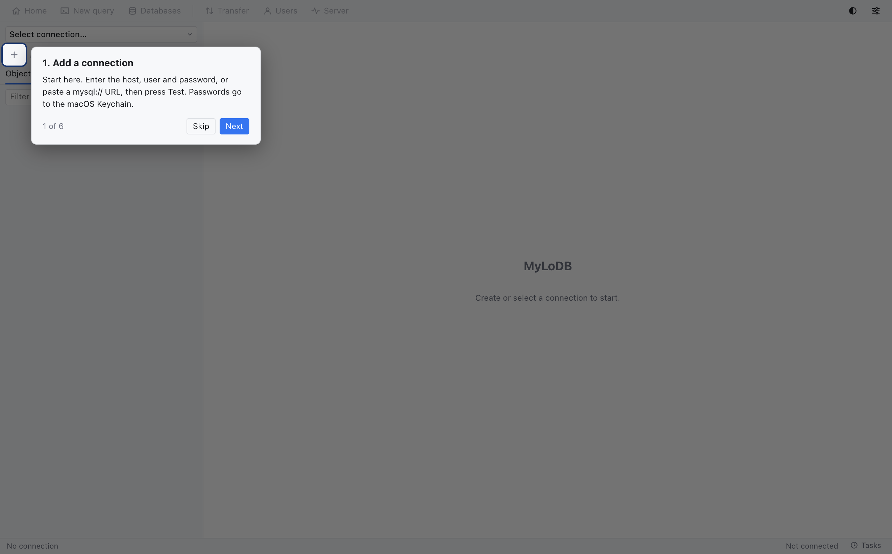

## 2. Add a connection

Click **+** above the object tree (or **Database → New Database Connection…**).

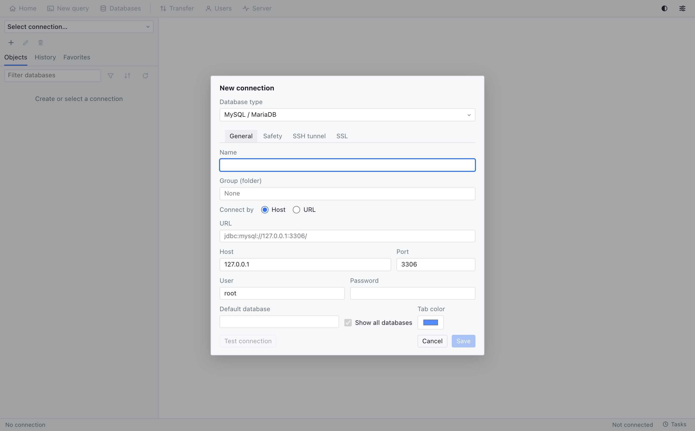

* **Name, host, port, user, password.** You can also paste a `mysql://user@host/db` or JDBC URL under *Connect by URL*. Passwords are stored in the macOS Keychain, never in the app's database or in logs.
* **Group (folder).** Connections with the same group name are listed together in the picker.
* **Test** connects once and shows the server version and the TLS cipher, or the server's exact error.
* **SSH tunnel** (password or private key; the host key is shown for confirmation and a changed key blocks the connection) and **SSL** modes (verify, verify CA, skip verify, client certificates).
* **Show all databases** off lists only the default database: for shared hosting where you own one database.

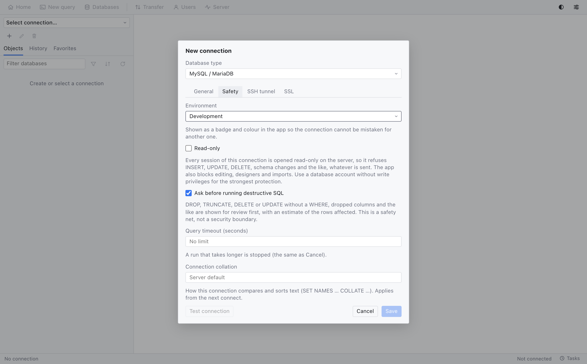

The **Safety** tab sets the **Environment** (Development, Staging, Production), a server-enforced **Read-only** session, a **query time limit**, and whether destructive SQL is reviewed first.

Several connections can be open at once; each is a tab above the workspace. Closing a tab disconnects only that connection. Each connection remembers its own open tabs and tree state.

### SQLite files

Choose **Database type → SQLite file** in the connection dialog, pick the file with **Browse…** and press **Test connection**. A SQLite connection:

* opens the file **writable**, unless you tick **Open read-only** (then it is opened by the read-only flag with `query_only`, and nothing can change it). Opening a file never creates one; foreign keys are enforced on a writable connection;
* edits rows in the data grid (staged, previewed as SQLite SQL, applied in one transaction, a failed change rolls the batch back) and runs `INSERT`, `UPDATE`, `DELETE` and DDL in the editor. A table needs a primary key to be edited in the grid; views are read-only;
* browses tables, views, triggers, columns and indexes (the primary key is shown as `PRIMARY`), runs SQL with results as NULL-aware text (BLOBs as hex), and pages, filters, sorts and counts a table in the data grid (counts are exact; `REGEXP` is not available);
* has no server home, users, server tools, events, routines or dump-based backup: those buttons are disabled and their tooltips say why;
* does not yet offer the table designer, export from a table, or cancelling a running query.

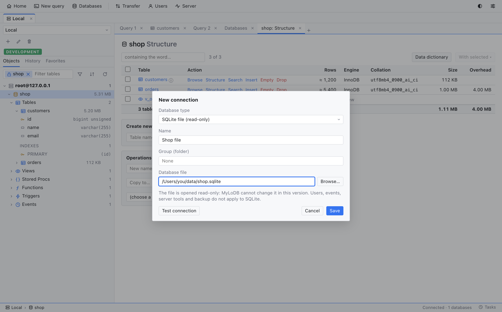

### Updates

From version 0.4.0 MyLoDB checks for a new release a few seconds after it starts and every six hours (**Help → About → Check for updates automatically** switches this off; **Help → Check for Updates…** checks at once). When one is found a dialog shows what changed in it and offers:

* **Update now**: downloads the update (with progress), replaces this copy of MyLoDB and restarts it. Connections, settings and open tabs are kept.
* **Later**: asks again at the next check.
* **Skip this version**: does not offer this version again on its own; a manual check still does.

Updates are signed by the project's key and refused if the signature does not match. MyLoDB contacts only GitHub (the release's `latest.json`) for this, and sends nothing about you or your databases.

## 3. Browse objects

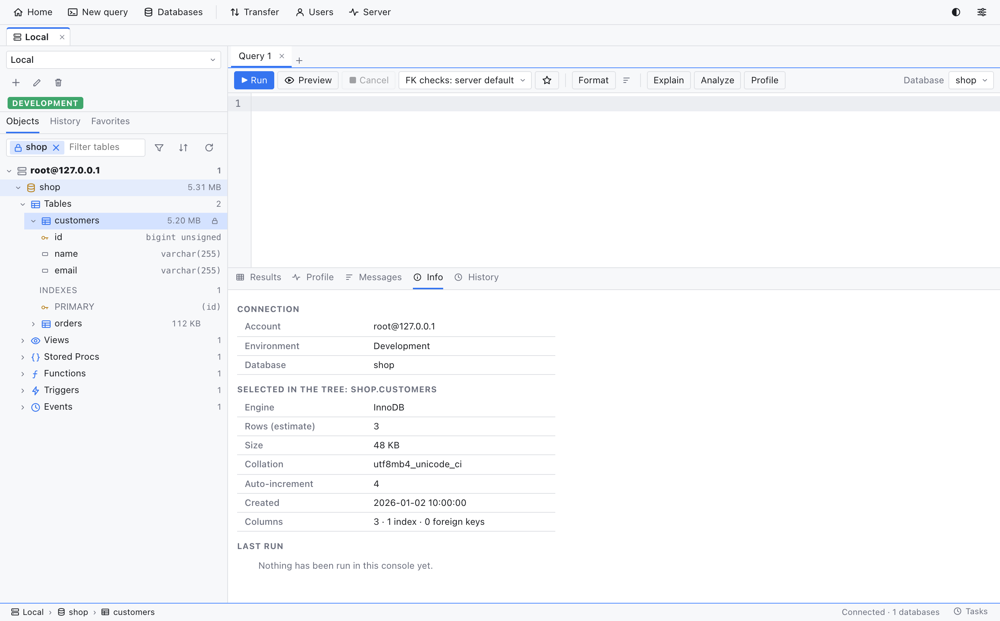

* The tree shows databases, tables, views, procedures, functions, triggers and events, with sizes. **Click** a database to lock the filter to it; click a table to see its columns and indexes.
* **Filter** (⇧⌘B): type part of a name. Operators: `/regex/`, `type:view`, `db:shop`, `col:email`. The filter icon switches which object kinds are searched.
* **Double-click** a table to open it. **Right-click** for data, properties, SELECT/INSERT/UPDATE/DELETE samples, rename, duplicate, drop. On a database: Structure, Databases, Create, **Alter database…**, Drop. On a procedure or function: show or edit the definition, **Rename…**, drop.
* **Drag** a database, table or column into the editor to insert its quoted name.
* The **Info** tab under the editor shows facts about what is selected in the tree: for a table the engine, rows, size, collation, auto-increment, created, columns, indexes and foreign keys; for a database the object counts, size and rows. (It sits there, not in the sidebar, so the tree keeps its space.)
* The sort button orders tables by name or by size. **F5** refreshes.

## 4. Run SQL

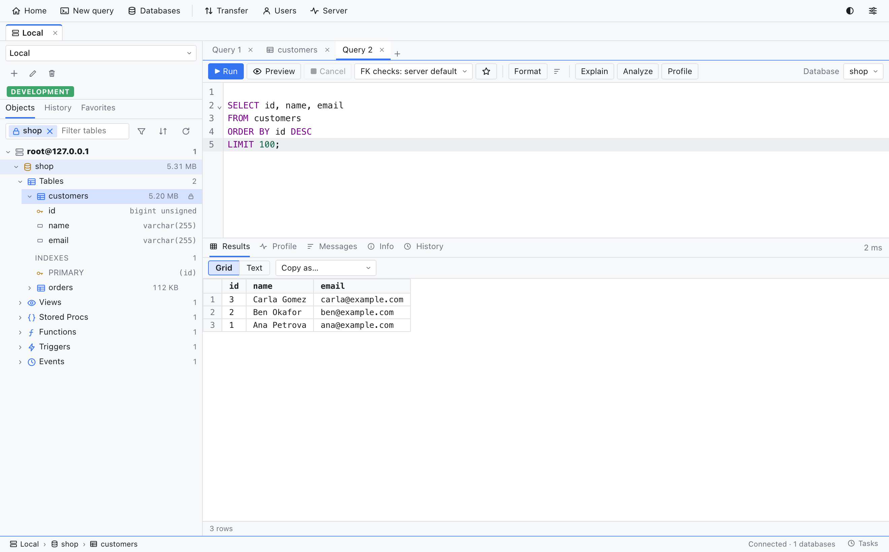

* **⌘T** opens a script. **⌘↵** runs the selection, or the whole script if nothing is selected. `DELIMITER` is supported.
* **Preview** shows the statements and a risk review before anything runs. **Cancel** stops the running statement. **FK checks** can be switched off for a run.
* Autocomplete knows tables, columns, aliases, functions and keywords, and works from the in-memory object index, so it needs no server round trip. **⇧⌘F** formats. **Explain**, **Analyze** and **Profile** show how a query ran.
* Result tabs: **Results**, **Profile**, **Messages**, **Table Data**, **Info**, **History**. Switch to **Text** for a mysql-client style output, or **Copy as** TSV, CSV, JSON, Markdown or INSERT.
* **History** and **Favorites** (with folders) are tabs in the sidebar. File → **Open SQL File…** and **Save** work with `.sql` files.

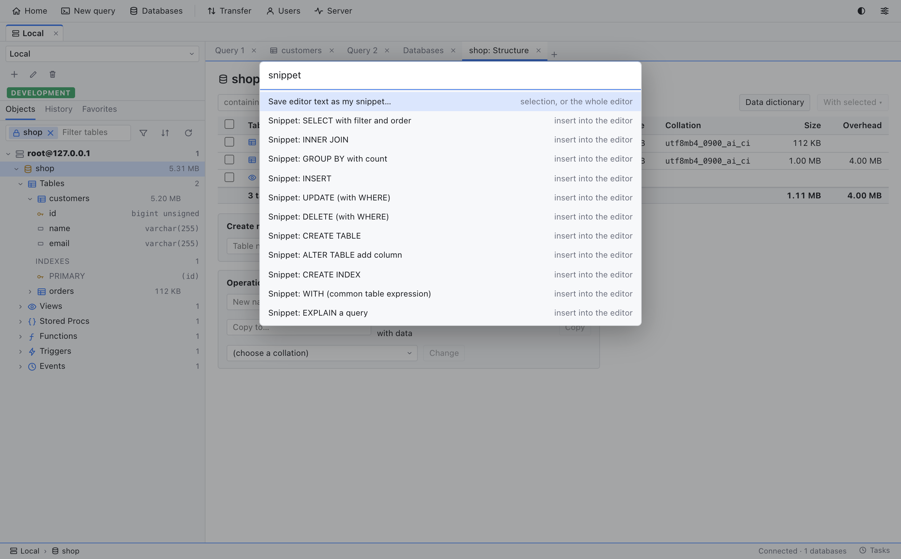

**⌘K** is the command palette: every action, every table, built-in SQL snippets, and your own. To save a snippet, write or select SQL and choose **Save editor text as my snippet…**; later type its name to insert it, or "delete my snippet" to remove it.

## 5. Work with table data

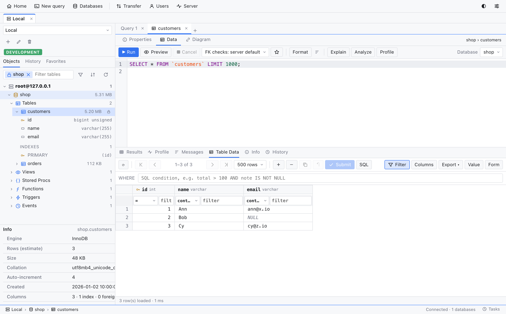

* The grid pages through the data on the server. The **SL** column is the row number: drag its edge to resize it, click it to sort by the primary key (ascending, descending, off). Edit a cell by double-clicking; edits are **staged** and written together in one transaction when you save. Rows are matched by primary or unique key; a table without one is read-only.
* Filter row (contains, =, ≠, starts/ends with, <, ≤, >, ≥, between, in, regexp, NULL, empty), a free-form WHERE, and multi-column sort.
* Foreign-key cells open a picker; ⌘-click jumps to the referenced row. The value panel shows text, JSON, hex and images, and uploads or saves BLOBs.
* Export the table or any SELECT to CSV, JSON, JSON Lines (optionally gzip), SQL, XML, HTML or Excel, as a cancellable background job with progress. Running jobs appear under **Tasks** in the footer.

### What each menu does

* **File**: New SQL Script, Open SQL File, Save, Save As, Close Tab; Refresh (reload the tree); **Import Data** (CSV, TSV, TXT, JSON or JSON Lines into a table); **Export Data** (any SELECT to a file); **Backup / Restore**; **Run SQL File** (a big `.sql`, zip or folder, streamed from disk).
* **Edit**: Undo, Redo, Cut, Copy, Paste, Select All, Format SQL.
* **Search**: **Search Objects** (the sidebar filter, ⇧⌘B); **Search Data in Database** (finds a value in any table, with progress and Cancel; "whole value" and "include non-text columns" options); **Command Palette** (⌘K).
* **SQL Editor**: new script (optionally in the selected database), Visual Query Builder, ER Diagram, Execute, Preview Before Running, Explain Plan, Format SQL.
* **Database**: New or Edit Connection, Disconnect, Server Home, Databases, Tables of Selected Database, New Table, **Compare Schemas** (make a target database's tables match a source; pick the changes, read the SQL, apply), **Index Advisor** (duplicate, redundant, missing and unused indexes), and Tools: Users and Privileges, Server Tools (overview, charts, processes, variables, status, maintenance, logs), Engines, Charsets, Replication.
* **View**: Toggle Sidebar (⌘B), Theme System, Light or Dark. **Help**: User Manual, Quick Tour, Keyboard Shortcuts (⌘/), Check for Updates, About.

### Filtering and sorting in the grid

The filter row (toolbar button) gives each column an operator: contains, doesn't contain, =, ≠, starts with, ends with, >, ≥, <, ≤, between, in (a, b, …), regexp, is NULL, is not NULL, is empty. Column filters combine with AND, and the **WHERE** box adds your own condition. Click a header to sort up, down, off; Shift-click adds a column; the SL header sorts by primary key. **Count** gives an exact total. SQLite supports everything except `regexp`.

### Long text, JSON, files and images

TEXT, LONGTEXT and JSON cells open in an editor window (Apply ⌘↵, Set NULL, Copy; JSON adds a validity badge, Format and Minify). The value panel shows a cell as Text, JSON, Hex or Image. **Upload…** puts a file from disk into a BLOB cell and **Save…** writes it out; uploads are staged until Submit.

## 6. Design tables and administer a database

* **Table designer:** columns, types, defaults, generated columns, indexes, foreign keys, engine, charset and collation. It shows the exact `ALTER TABLE` before it runs, and renames keep data.
* **Databases page** (Database → Databases…): sizes, table counts, collation, check all, **bulk drop**, create with a collation.

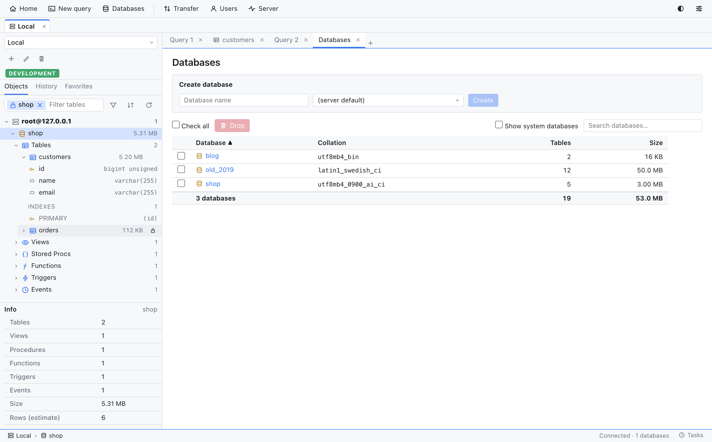

* **Structure page** of a database: every table with rows, engine, collation, size and overhead, a filter, row actions, and a **With selected** menu: copy, show create, export, empty, drop, analyze, check, checksum, optimize, repair, add or replace a prefix, copy with a prefix. Also **Operations** (rename by copy, copy, collation) and a printable **Data dictionary**.

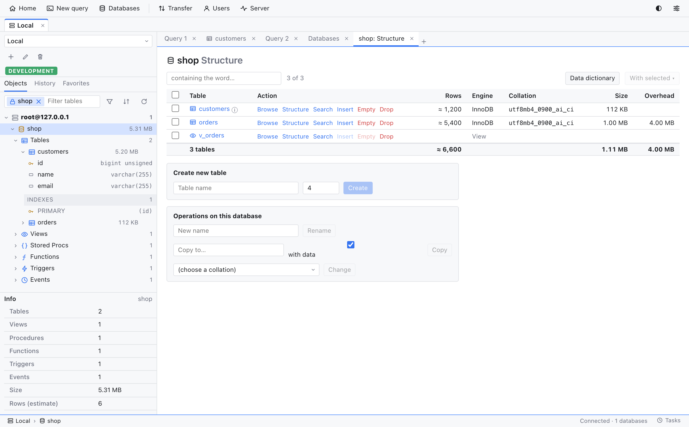

* **Preview SQL, then run:** every drop, empty, rename, copy and bulk operation shows the exact statements first, with a switch for foreign key checks. On production you type the name to confirm.
* **Users and Privileges:** create, rename, lock and drop accounts, and global, database, table and column privileges, shown as the exact GRANT / REVOKE changes with passwords masked.
* **Server Tools:** overview with live queries per second, process list (stop query, kill connection), variables (edit with confirmation), status with rates, CHECK / ANALYZE / OPTIMIZE / REPAIR for many tables, and logs. **Engines, charsets, replication** is under Tools.

### Data search

Right-click a database → **Search data…** (or **Search → Search Data in Database…**) finds a value anywhere in the database. Type the text, choose *contains* or *whole value*, optionally include numbers and dates, and press **Search**.
Every base table is read once (one `COUNT(*)` over its searchable columns), and only the tables that match get a second query for the per-column counts, so a miss costs one scan. Results list each matching table with its row count and the columns that matched; click a column to open the table filtered to it.
`%` and `_` in the text are taken literally, matching follows each column's collation (usually case-insensitive), BLOB columns are never searched, views are not searched. **Cancel** stops between tables and kills the running statement; what was found so far is kept.
### Index advisor

Right-click a database → **Index advisor…** analyses the index definitions of every table: **duplicate** indexes (same columns in the same order, or a plain index repeating the primary key or a unique index), **redundant** ones (a plain index that is only the start of another index), and **foreign keys without an index** that starts with their columns. Unique indexes are never called redundant, full-text and spatial indexes are left alone, and an index with a prefix length is only matched with an identical one.
Drops are pre-selected, adding an index is not (it costs write speed and space). **Preview and apply…** opens Preview SQL with exactly the chosen `DROP INDEX` / `CREATE INDEX` statements. A second list shows indexes the server reports as unused since it started (`sys.schema_unused_indexes`): check the uptime before dropping one.
### ER diagram

Right-click a database → **ER diagram…** draws every table as a box with its columns and every foreign key as a line. Tables are placed by foreign-key depth: tables that reference nothing sit on the right, the tables that reference them to their left, and tables with no relation underneath. Drag a box by its header, zoom with − / +, filter by name, tick **only tables with relations**, **double-click** a table to open it, and **Copy as Mermaid** to paste the shown tables and relations into documentation as `erDiagram` text. The whole database is read in three queries, so hundreds of tables load at once; each box shows the first 14 columns.

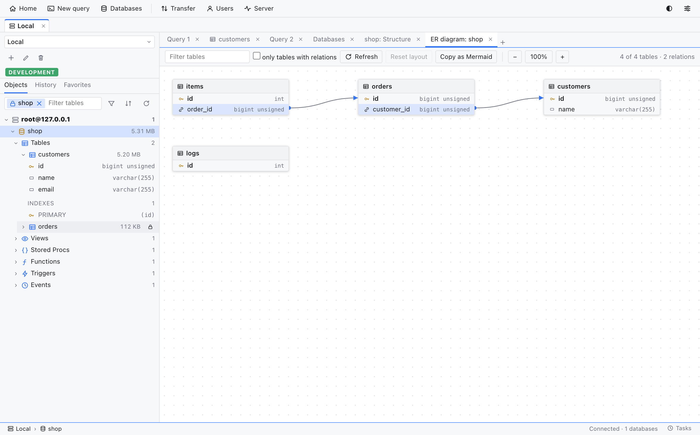

### Visual query builder

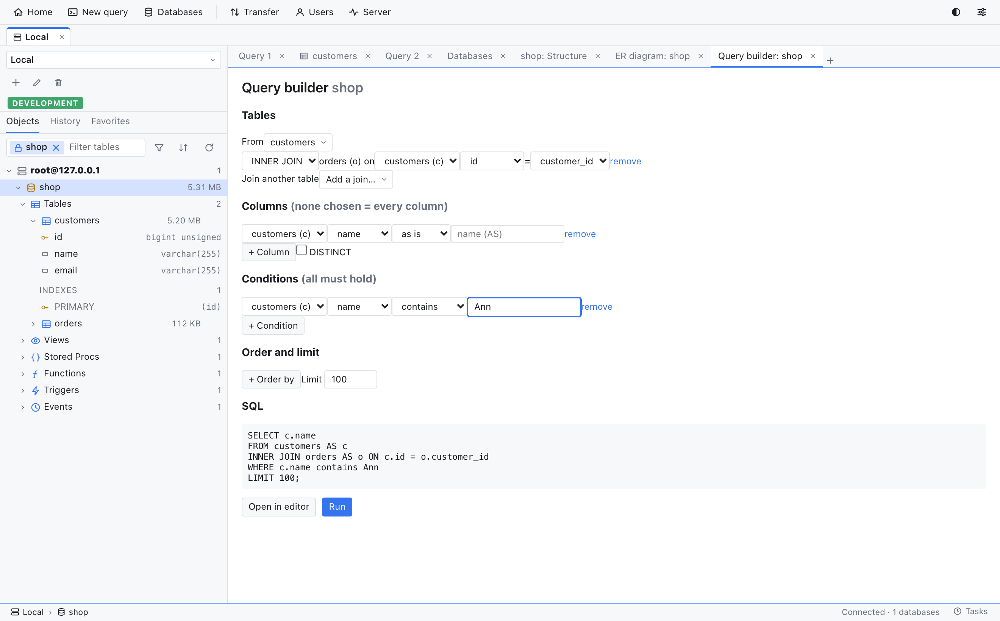

Right-click a database → **Query builder…** (or **SQL Editor → Visual Query Builder…**). Choose a **From** table, add joins (the ON columns are filled in from a foreign key between the tables when there is one; you can change them), tick **Columns** (none chosen means every column; each can have COUNT, SUM, AVG, MIN or MAX and a name), add **Conditions** (all must hold: =, ≠, <, ≤, >, ≥, contains, starts with, ends with, in, between, is NULL, is not NULL), an **order**, DISTINCT and a **limit**. The SQL is rebuilt as you go; **Open in editor** puts it in a query tab and **Run** also runs it.
The statement is built by the backend with the connection's quoting: names are checked against the tables you chose, values are quoted, `%` and `_` in "contains" text are literal, aggregates group by the plain columns, and a mistake (a join that refers to a later table, DISTINCT ordered by an unselected column) is explained instead of sent to the server.

### Server charts

**Server → Charts** samples the global status counters every 1, 2, 5 or 10 seconds and draws the last five minutes as lines: queries per second, statements per second (SELECT, INSERT, UPDATE, DELETE), connected and running connections, network bytes per second, InnoDB rows read, inserted, updated and deleted per second, and slow queries per second. Counters are turned into per-second rates between two samples (a counter that goes back, as after a restart, leaves a gap instead of a spike); connection counts are plotted as they are. Hover for the value at that moment. **Pause** stops sampling, **Clear** empties the history, and a series the server does not report (MariaDB names some counters differently) is said so instead of drawing an empty chart.

### Import JSON

In **File → Import Data…** choose a `.json`, `.jsonl` or `.ndjson` file with **Browse…**. MyLoDB turns it into a temporary CSV once and the ordinary CSV import continues with it (preview, column mapping, creating a table from the file, insert / skip / update / replace, all-or-nothing or continue on error).
Accepted: an array of objects, JSON Lines (one object per line), or a single object. The columns are the keys in the order they first appear. A key a row lacks and a JSON `null` are both **NULL**; strings are kept as they are; numbers and `true` / `false` become their JSON text; nested objects and arrays are loaded as compact JSON text. An array is read into memory, so it is limited to 256 MB: use JSON Lines for anything larger (those are streamed). A string that is exactly `\N` would be read as NULL.

### Compare schemas

Right-click a database → **Compare schemas…** opens a tab that makes **this** database (the target) match another one (the source), which can be on any open connection.
Pick the source connection and database, press **Compare**, and read the list: *New in source* (a `CREATE TABLE`), *Different* (an `ALTER TABLE`: changed and added columns, dropped columns, indexes, keys, options) and *Only in target* (a `DROP TABLE`).
Tables only the target has are **never pre-selected**. **Show SQL** reveals each table's statements; **Preview and apply…** opens Preview SQL with exactly the chosen statements: creates and alters first, then the foreign keys of new tables (so creation order never matters), then any drops.
Only tables are compared, not views, routines, triggers or events. It uses the same statement generator as the table designer, and the integration test applies a comparison to a real server and compares again to prove the result is empty.

## 7. Stay safe on production

* The **Environment** sets a colour band and badge. Production asks you to type a name before destructive operations, and saving grid changes asks for confirmation.
* **Read-only** is enforced by the server for the session, not just by the app.
* A **query time limit** kills runaway statements.
* Destructive statements (DROP, TRUNCATE, DELETE or UPDATE without WHERE) are reviewed with an estimate of the rows affected before they run.

### Saved passwords

Under **Preferences → Security → Saved passwords** you choose where connection passwords are kept. The **macOS Keychain** is the default; because MyLoDB is not signed with a paid Apple certificate, macOS asks again for each saved connection after an update. The **encrypted file** moves every saved password out of the Keychain into one file locked by a master password (at least 8 characters; XChaCha20-Poly1305, key from Argon2id). You type it once per session and the Keychain prompts stop. You can change the master password, or move everything back to the Keychain, from the same page. **If you forget the master password the file cannot be opened by anyone**: the unlock window offers to delete it, your connections stay, and you type each password again.

## 8. Backup, restore, import and export

File → **Backup / Restore…** and **Import Data… / Export Data…**.

* **Backup** writes one consistent snapshot as SQL (structure, data, views, routines, triggers, events), as one file or a file per table, optionally zipped. A cancelled backup removes its partial output.
* **Restore** runs a `.sql` file, a zip or a folder, streamed from disk, and lists errors with line numbers. **Preview script** shows the counts and the first statements first.
* **CSV import** detects the delimiter, previews rows, handles encodings, maps columns, and can insert, skip, update or replace; all-or-nothing or continue on error. It can also create a table from the file.

* **Export Data…** writes any SELECT as **CSV**, **JSON** (array of objects), **JSON Lines**, **SQL INSERT**, **XML**, **HTML table** or **Excel (XLSX)**; CSV lets you choose the text written for NULL, and gzip is optional (not for Excel). It streams from the server as a cancellable background job. **Copy as…** above a result copies TSV, CSV, JSON, a Markdown table or INSERT statements.
* Import options: delimiter, quote, encoding, header row, trim, the text that means NULL, new table or existing table, and what to do on a duplicate key (error, skip, update, replace). "Empty the table first" asks to confirm.

## 9. Preferences and themes

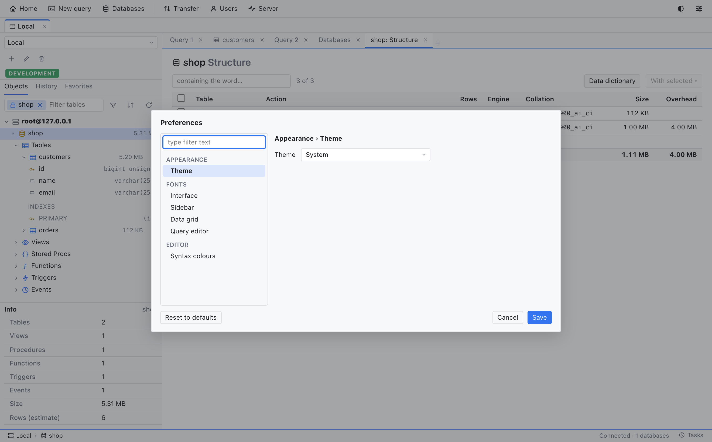

**⌘,** opens Preferences: theme (light, dark, system), and font family, size and weight for the interface, sidebar, data grid and query editor, editor line height, and four editor colour schemes (default, multi-colour, Solarized, high contrast), previewed live.

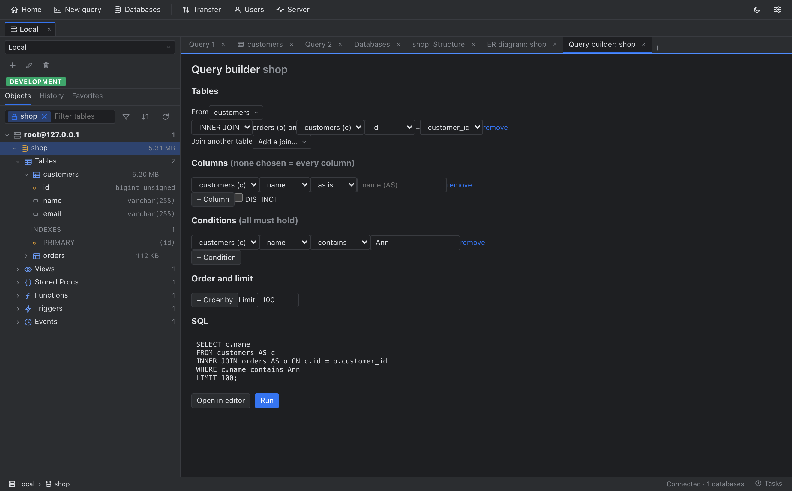

## 10. Performance and large tables

Measured on 2026-11-21 against a local MySQL 9.7.2 with a 10-million-row table of about 1 GB (larger than the 128 MB buffer pool). Single runs on one machine; full method and limits are in [BENCHMARKS.md](BENCHMARKS.md).

| Operation | 10M rows |
|---|---:|
| First page (500 rows) | 6 ms |
| Page at 50 % by keyset paging | 3.3 ms (OFFSET: 1,190 ms) |
| Last page by keyset | 2.0 ms (OFFSET: 2,336 ms) |
| Estimated row count | 0.9 ms (exact `COUNT(*)`: 820 ms) |
| Export to CSV | 9.4 s, about 1.06 million rows/s, 638 MB |
| Export to JSON | 15.0 s |
| Export to CSV + gzip | 12.8 s, 204 MB |

* Memory stays flat (5 to 11 MB) during a 1.4 GB export.
* The grid draws only visible rows: a page of 5,000 rows draws 32.
* Filtered row estimates can be far off, so the grid shows "≈" and offers a cancellable **Count** button.
* Keyset paging needs a primary key of integer, text or date columns; other tables fall back to OFFSET automatically.
* Not measured: wide tables (hundreds of columns), MySQL 5.7 / 8.0 / 8.4 and MariaDB timings, network drops, and the real desktop window (only a headless browser with a mock was measured for the grid).

## 11. Keyboard shortcuts

The same list opens anywhere with **⌘/** (Help → Keyboard Shortcuts).

**Everywhere**

| Shortcut | Action |
|---|---|
| ⌘K | Command palette: every action, table and theme |
| ⌘, | Preferences |
| ⌘B | Show or hide the sidebar |
| ⇧⌘B | Search objects in the sidebar |
| F5 | Refresh the object tree |
| ⌘/ | This list of shortcuts |
| Esc | Close a window, or cancel an edit |

**Tabs and the SQL editor**

| Shortcut | Action |
|---|---|
| ⌘T | New SQL script |
| ⌘W | Close the tab |
| ⌘↵ | Run the selection, or the whole script |
| ⇧⌘F | Format SQL |

**Object tree**

| Shortcut | Action |
|---|---|
| F2 | Rename the selected table |
| F4 | Open the selected table's properties |

**Data grid**

| Shortcut | Action |
|---|---|
| Enter or F2 | Edit the cell (long text and JSON open in a window) |
| Tab | Save the cell and move right |
| ⌘↵ | Submit the pending changes |
| ⌘C | Copy the cell |
| Delete | Delete the selected rows |
| Arrows, PageUp, PageDown | Move between cells |
| ⌘Home, ⌘End | First and last row of the page |
| ⌘ click | Follow a foreign key to the row it points to |

## 12. Troubleshooting

| Problem | What to do |
|---|---|
| "Apple could not verify MyLoDB" or "damaged" | See [section 1](#1-install-and-first-launch): **Open Anyway**, or the `xattr` command. |
| Cannot connect | Check host, port, the account's allowed host and the SSL mode. **Test** shows the server's exact message. |
| Only one database is listed | Turn on **Show all databases** in the connection dialog. |
| A table is read-only in the grid | It has no primary or unique key. |
| Preview or Run is refused on a connection | The connection is read-only. Edit the connection to change that. |

Found a bug? [Open an issue](https://github.com/farookhridoy/mylodb/issues). Please leave out passwords and customer data.

## About

MyLoDB is open source under the Apache-2.0 licence. Author: Omar Farook Hridoy ([farookhridoy.com](https://farookhridoy.com)), [thelarasoft.com](https://thelarasoft.com). MyLoDB is independent and is not affiliated with SQLyog or Webyog. It sends no telemetry.
